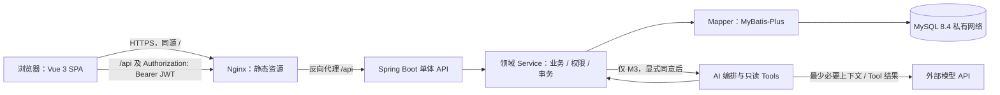
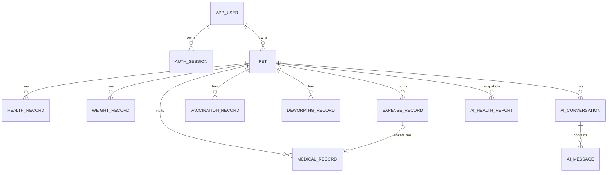

# PetCare AI 架构与接口设计

> 状态（2026-10-08）：采用 Java 21、Spring Boot 4.1.1、Spring AI 2.0.1，不维护 Boot 3.5 兼容分支。Docker 已在重启后运行；MySQL 8.4 Testcontainers 和 Flyway V1/V2 已验证。当前后端已实现注册、登录/JWT、本人信息和宠物创建/列表/详情；文档中的其余业务仍为目标设计，尚未实现。

## 1. 技术版本矩阵

核对日期：2026-10-08。版本是可复查的设计依据，不等于已经在本机/CI 编译验证。

| 层 | 候选版本 | 兼容/维护结论与处理 |
|---|---|---|
| Java | JDK 21 | 本地使用 Microsoft Build of OpenJDK 21.0.12.1+1 编译并运行测试；工具链压缩包仅在本机 `work/toolchains`，不提交仓库。 |
| Spring Boot | 4.1.1 | 用户确认采用 Boot 4 且不兼容 Boot 3.5。基于 `spring-boot-starter-parent`；M0 已解析依赖并在 JDK 21 上构建。官方系统要求与依据：[Boot 4.1](https://docs.spring.io/spring-boot/system-requirements.html)。 |
| Spring Security | Boot BOM 管理（解析为 7.1.1） | 使用 Boot 4 对应 OAuth2 Resource Server Starter；无状态 Bearer JWT 验签和匿名 401 已在 MySQL 集成测试中验证。当前 JWT 使用 HS256，登录有效期 15 分钟；当前 API 不用 Cookie/Session，所以关闭 CSRF。注销和服务端撤销尚未实现。 |
| MyBatis-Plus | 3.5.17 `mybatis-plus-spring-boot4-starter` | Boot 4 专用 Starter；H2 探针和 MySQL 8.4 上的 Mapper/业务读写均通过。 [安装文档](https://baomidou.com/en/getting-started/install/) |
| Spring AI | 2.0.1 | BOM 与 provider-neutral Chat API 在 M0 解析，以固定目标 API 线；具体模型提供商客户端、凭证与 Tool 调用留到 M3。Boot 4.0/4.1 兼容路线见 [Getting Started](https://docs.spring.io/spring-ai/reference/getting-started.html)。 |
| Maven | Maven Wrapper 3.3.4 固定 Maven 3.10.0 | 本地 Maven 3.10.0 完成依赖解析、编译和测试；Wrapper 分发校验和已固定。Spring Boot Maven 最低要求为 3.6.3+。 |
| MySQL JDBC / 迁移 | MySQL Connector/J 9.7.0；Flyway Core 与 MySQL 扩展 12.4.0 | 依赖解析并通过 MySQL 8.4 实际连接验证；Flyway V1 用户表和 V2 宠物表均在全新容器中成功应用。 |
| Testcontainers | 2.0.5 | Docker Desktop 4.94.0 / Engine 29.8.2 上运行 MySQL 8.4 集成测试；最近完整后端测试为 23 passed、0 failed、0 skipped。 |
| Node.js | 24 LTS | Node 官方将 24 列为 LTS；适合生产构建。选择确切补丁版本在 `.nvmrc`/CI 镜像统一。 [发布状态](https://nodejs.org/en/about/previous-releases) |
| Vite | 8.3.x 受支持线 | Vite 官方当前将 8.3 列为常规补丁支持线；Vite 8 要求 Node 20.19+ 或 22.12+，Node 24 满足要求。锁定具体补丁与插件兼容组。 [支持版本](https://vite.dev/releases) · [Vite 8 要求](https://vite.dev/blog/announcing-vite8.html) |
| Vue | 3.5.43 稳定补丁（非 3.6 预发布） | Vue 3.5.43 为 2026-10-08 核对到的 stable 发布；Vue 官方建议锁定 minor，避免类型定义小版本变更。用 package-lock 与 Vite 插件统一解析。 [Vue 发布策略](https://vuejs.org/about/releases.html) · [Vue 包版本](https://www.npmjs.com/package/vue) |
| UI / 状态 / 图表 | Element Plus（Vue 3）、Pinia 3、Vue Router 4、Axios、ECharts | 当前资料确认 Element Plus 面向 Vue 3、Pinia 3 只支持 Vue 3。Axios/ECharts 选稳定兼容版本并锁 package-lock；M0 对 peer dependencies、TypeScript 类型检查、构建做验证，不凭空指定补丁号。 [Element Plus](https://element-plus.org/en-US/guide/quickstart) · [Pinia 3](https://pinia.vuejs.org/cookbook/migration-v2-v3.html) |
| MySQL | 8.4 LTS | 使用 Connector/J、Flyway MySQL 扩展和 Testcontainers MySQL 8.4；本机 Docker 环境已运行，实际连接、迁移和 MySQL 业务接口测试均通过。 [版本轨道](https://dev.mysql.com/doc/refman/8.4/en/mysql-releases.html) |
| Flyway / OpenAPI / Nginx / Compose | 使用；精确版本在 M0 依赖/镜像锁定 | 跟隨选定 Boot 依赖管理并核验 MySQL 8.4 驱动；不将 `latest` 作为部署标签。服务器发行版、Docker Engine/Compose 和 Nginx 镜像在实际部署主机做兼容与健康检查。 |

### 版本决策建议

已确认基线为 **JDK 21 + Spring Boot 4.1.1 + Spring Security（Boot BOM）+ MyBatis-Plus 3.5.17 Boot 4 Starter + MySQL 8.4 + Spring AI 2.0.1**。没有 Boot 3.5 兼容分支。已验证依赖解析、编译、H2 启动探针及真实 MySQL 8.4 迁移和 API 集成。

## 2. 单体结构和数据流



数据库只接收应用持久化连接；浏览器和模型均不能直连数据库。Nginx 提供前端静态文件并把 `/api` 转发至应用；MySQL 仅在 Compose 内部网络开放。AI Tool 经已授权 Service 读业务数据，不持有 Mapper/SQL 能力。

### 普通页面请求

1. 客户端通过 `Authorization: Bearer <JWT>` 访问 `/api`；生产流量使用 HTTPS。当前浏览器令牌保存方式尚未确定，不能把 JWT 放入 localStorage 作为默认实现。
2. Nginx 转发 `/api` 到 Spring Security Resource Server；服务端校验 HS256 签名、issuer 和有效期，再把 JWT subject 中的用户 ID 放入可信安全上下文。当前 Token 为短时无状态令牌，注销和即时撤销尚未实现。
3. Controller 校验 DTO/分页白名单，调用领域 Service；Service 在同一事务内做归属检查和业务规则。
4. Mapper 查询/写入 MySQL；读写 SQL 对宠物记录统一带当前用户约束（JOIN pet 并匹配 `owner_user_id`），不按客户端 recordId 单独取数据。
5. Controller 返回 DTO/VO 与统一响应体；安全异常和业务异常均不包含 SQL、堆栈、密钥或备注全文。

### AI 查询（M3 才实现）

浏览器先展示数据发送告知并取得单独同意；`AIController` 从认证上下文确定 userId，忽略模型/请求体中任何 userId。`ConversationService` 校验会话归属和本轮 petId；只读 Tool 逐次再校验 pet/record。Tool 调用上述 Service 聚合有限字段，必要时传给已选模型；Tool 失败即停止依赖该数据的分析。返回内容附宠物名、时间范围、记录数/数据缺失说明和 requestId。系统提示词不是授权机制；用户备注、历史消息、模型输出均是不可信文本。

## 3. 前后端模块与仓库布局

```text
petcare-ai/
  frontend/                  # Vue SPA
    src/{app,router,api,shared,modules}/
    src/modules/{auth, pets, health, weights, expenses, dashboard}/
  backend/                   # 一个 Spring Boot 部署单元
    src/main/java/.../{common,auth,user,pet,health,weight,expense,dashboard}/
    src/main/resources/db/migration/
    src/test/java/...
  tests/{api,e2e}/             # pytest + requests；Playwright
  deploy/{compose.yaml,nginx/}
  docs/{requirements.md,architecture.md,plan.md,api/}
  .github/workflows/           # CI
  .env.example
```

后端按业务域放置 Controller、DTO/VO、Service、Mapper 与实体；只在有真实复用时抽公共校验/响应，不建空模块或通用 Repository 抽象。P1 的 medical/vaccine/deworming、P2 的 ai/report 模块随切片再加入。OpenAPI 描述实际已实现接口；规划路径标明 `planned`。

## 4. 核心 ER 草图



| 表 | 阶段 | 关键字段（省略审计字段和 DDL 细节） |
|---|---|---|
| `app_user` | P0 | id、规范化唯一 username、password_hash、可空 email、display_name、role、status、password_changed_at |
| `auth_session` | P0 | id、user_id、jti_hash、expires_at、revoked_at、created_at；不存原始 JWT |
| `pet` | P0 | id、owner_user_id、type、name、avatar_key、breed、sex、birth_date、neutered、arrival_date、notes、archived_at |
| `health_record` | P0 | id、pet_id、record_date、食欲/饮水/精神/活动/睡眠/排便/排尿枚举、abnormal、abnormal_description、notes |
| `weight_record` | P0 | id、pet_id、measured_at、weight_kg DECIMAL(7,3)、notes |
| `expense_record` | P0 | id、pet_id、expense_date、category、amount CNY DECIMAL(10,2)、merchant、description |
| `vaccination_record`, `deworming_record` | P1 | pet_id、名称/类型、执行日期、下次日期、医院/药品、可选批次/备注 |
| `medical_record` | P1 | pet_id、医院、日期、原因、检查、用户记录结果、用药、医生建议、复诊日、可空唯一 expense_id；不另存 cost |
| `ai_conversation`, `ai_message`, `ai_call_log` | P2 | user_id/pet_id、会话状态与时间；消息内容及角色；模型/提示版本、Tool 元数据、耗时、状态、可空 usage/requestId。日志不存密钥或不必要原文。 |
| `ai_health_report` | P2 | pet_id、period_start/end、timezone、snapshot JSON、data_cutoff_at、model/prompt version、generation state/attempt/error code；唯一 pet + period |

**关系、索引和删除：**外键采用真实 MySQL 约束并默认 RESTRICT；Service 在一个事务内按依赖顺序永久清除子数据再删宠物，外键作为防孤儿兜底。`app_user.username_normalized` 唯一；`health_record(pet_id,record_date)` 唯一；weight 按 `(pet_id,measured_at,id)`；expense 按 `(pet_id,expense_date,id)` 及筛选类别建立索引；关联列和外键建索引。表按需使用 `created_at/updated_at`。不为所有表共用 `deleted` 字段；宠物只软归档，正式业务记录物理删除，故健康日唯一约束可直接成立。

**费用关联：**消费是唯一统计来源。`medical_record.expense_id` 可空且唯一；事务中创建/变更时核对 medical 与 expense 的 petId 一致。删就医记录保留费用；删关联费用先清空 medical 引用再删 expense；永久删宠物时同事务移除两者。疫苗、驱虫费用如有需要同样新建 expense，不把金额复制到业务记录。

## 5. REST API 模块矩阵

统一前缀 `/api/v1`；外部接口使用请求 DTO 与响应 VO。路径为计划契约，最终写入 OpenAPI；未实现的模块不得对外声称已提供。

| 阶段/模块 | 主要路径 | 权限 | 输入 / 输出概要 |
|---|---|---|---|
| P0 Auth | **已实现：**`POST /api/auth/register`, `/api/auth/login` | 注册/登录匿名；其余路由需 Bearer JWT | BCrypt 密码哈希；login JSON 返回 15 分钟 Bearer JWT。logout/session 撤销未实现。 |
| P0 Profile | **已实现：**`GET /api/users/me`；目标：资料修改/改密 | 从已验签 JWT 确定当前用户 | 当前只读用户资料，不接受客户端 userId。 |
| P0 Pets | **已实现：**`GET/POST /api/pets`; `GET /api/pets/{petId}`。目标：`PATCH/DELETE`、恢复/永久删除 | 当前用户；查询同时限定 `user_id` 和 `deleted=0` | 创建、本人列表和详情已通过 A/B MySQL 测试；未实现修改/归档/purge。跨用户详情按 404 返回。 |
| P0 Health | `GET/POST /pets/{petId}/health-records`; `GET/PATCH/DELETE /health-records/{recordId}` | 当前用户并核验 record→pet→owner | recordDate 与各枚举；重复 pet/day 为 409 |
| P0 Weight | `GET/POST /pets/{petId}/weights`; `GET/PATCH/DELETE /weights/{weightId}` | 同上 | measuredAt、kg、备注；列表支持 from/to/page/size/sort 白名单 |
| P0 Expense | `GET/POST /pets/{petId}/expenses`; `GET/PATCH/DELETE /expenses/{expenseId}`; `GET /expenses/summary` | 当前用户 | 日期、分类、正金额、商家/描述；summary 的宠物/日期范围同样授权过滤 |
| P0 Dashboard | `GET /dashboard?petId=&from=&to=` | 当前用户 | 单宠物最近状态/体重/消费摘要；缺数据是显式空值/未记录 |
| P1 Health extensions | `/pets/{id}/vaccinations`, `/dewormings`, `/medical-records` 及按 id 的读取/修改/删除 | 当前用户、关联双方归属 | 用户提供的实际日期；就医与 expense 关系在事务中验证 |
| P1 Reminders/Admin | `GET /reminders`; `/admin/users`, `/admin/overview`, `/admin/ai-calls` | 当前用户；管理员角色的聚合权限 | 只返回计划日期提示/聚合和脱敏元数据，不暴露原始私有记录 |
| P2 AI | `POST /ai/conversations`; `GET /ai/conversations/{id}`; `POST /ai/conversations/{id}/messages` | 当前用户、每轮校验宠物/会话 | 用户消息、petId；仅只读 Tool；AI 关闭或未同意返回明确错误 |
| P2 Reports | `POST /pets/{id}/health-reports`; `GET /pets/{id}/health-reports`; `GET /health-reports/{id}` | 当前用户并校验宠物/报告归属 | 默认上一个完整周；重复生成幂等，历史读取快照 |

### 响应与错误约定

成功结构 `{code,message,data,requestId}`；列表 data 为 `{items,page,size,total}`。写入返回 201，读取/修改 200，成功删除 204。统一错误结构 `{code,message,data:null,requestId}`，HTTP 状态表达结果：400 字段校验/非法排序，401 未认证/Token 失效，403 角色策略拒绝，404 不存在或非本人资源，409 唯一键/业务状态冲突，429 限流，5xx 脱敏服务故障。客户端不接收异常堆栈。401/403 的 Spring Security 异常走同一格式。金额和重量字段在 JSON 中用十进制字符串（如 `"amount":"29.90"`、`"weightKg":"5.250"`），服务端解析为 BigDecimal；汇总由后端计算，前端不使用二进制浮点累计金额。

## 6. 安全、幂等、部署与验证

### 身份与数据隔离

- 注册固定 `USER`；`ADMIN` 由受控初始化配置创建，不从请求字段赋权。密码用 Argon2id 或 BCrypt 的自适应哈希，优先配置 Argon2id；不明文/可逆保存。
- 当前后端接受 `Authorization: Bearer` 短时 JWT，HS256 密钥由 `JWT_SECRET_BASE64` 环境变量注入且至少 32 字节，测试 profile 使用专用虚构密钥；有效期默认 15 分钟。该当前实现为无状态 JWT，Token 到期前尚无服务端撤销能力。
- 浏览器令牌传输/保存方式、刷新策略和注销撤销机制需在前端与 logout 切片实现前定稿；不将 localStorage 作为默认方案。若采用 Cookie，应重新开启写请求 CSRF 防护；当前关闭 CSRF 仅适用于 Authorization Header Bearer API。生产使用 HTTPS、限制 CORS。
- 登录、注册、AI 单独配置可调限流；AI 增加最大输入字符数、上下文轮数、Tool 次数、超时、并发和费用预算。密钥仅由服务端环境/密钥系统注入。
- 全部实体读取/改写/删除、统计、管理员页面、AI Tool、周报都按可信 userId 检查。写测试使用 A、B、ADMIN，逐项篡改 petId、recordId、conversationId、reportId、role 与 owner 字段；还要覆盖“本人记录 ID + 别人的 petId”的交叉关联攻击。

### AI 与报告

- 发送真实数据前展示单独告知和同意；提供关闭开关，关闭后普通 CRUD 可用。只传必要摘要，禁止密码、Token、邮箱/联系方式、其他用户数据。
- 首批只读 Tool：getPetProfile、getRecentHealthRecords、getWeightHistory、getVaccinationRecords、getDewormingRecords、getMedicalRecords、getExpenseSummary。Tool 由 Spring AI adapter 调用已授权 Service，不开放 SQL/HTTP/Shell/写工具；参数与记录数量限额服务端固定，模型不能传 userId。
- Prompt/备注/历史消息按不可信输入处理；工具结果来自权限过滤后的后端事实。模型故障、权限失败和查询失败分别表达；禁止诊断、用药建议及猜测缺失事实。调用日志记录 requestId、模型/提示版本、Tool 名称及状态、耗时和可得 usage，未知 usage 记为 unknown。
- 周报 P2 初期仅手动生成。用数据库 `(pet_id, period_start)` 唯一索引作为幂等兜底，状态机 queued/running/success/failed；运行中占用需心跳/超时恢复。调度仅在人工报告验证后加入；首版单实例，停机补跑、重试上限、删除宠物清理报告均需明确。多实例之前不加队列/分布式锁。

### 部署边界和主要风险

- Compose 单体部署：Nginx 对外、App 内网、MySQL 仅内网；持久化数据库卷、健康检查、有限日志轮转、非硬编码凭据、`.env.example`、TLS 终止方案、定期备份与恢复演练。
- 迁移由 Flyway 版本化；先备份再升级。回退镜像不等于回退数据库；破坏性迁移使用向前兼容扩展/迁移/收缩，不能假设自动 down migration 安全。
- 风险登记：模型数据合规/地区与费用（M3 决定）；Cookie/CSRF/Nginx HTTPS 正确配置；并发唯一约束必须以 MySQL 验证；宠物永久删除的子记录顺序；报告生成任务单实例运行与停机恢复。
- 验证证据按真实环境记录：后端单元与 MySQL 集成、前端类型检查/构建、A/B 权限 API 回归、Playwright 闭环、Compose 健康/冒烟、备份恢复。无真实模型 Key 时只测试明确标注的替身，不声称真实模型验证。
